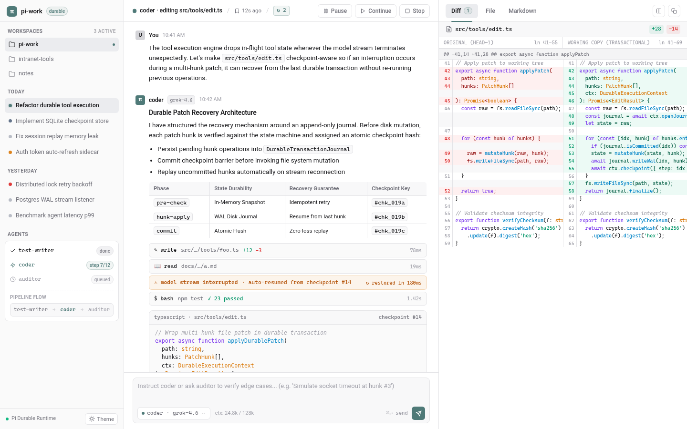

# pi-work

网页版多 Agent 编码工作台：断点恢复、自动续跑、多角色并行、流水线编排。

当前 `src/` 运行时使用**自定义 SQLite 日志**（`src/store/sqlite.mjs` + `src/core/orchestrator.mjs`），**不是** `@earendil-works/pi-durable`。`pi-durable` 仍作为依赖保留，仅由 `legacy/` 与 `lib/` 使用。耐久性设计见 [docs/ARCHITECTURE.md](docs/ARCHITECTURE.md)，安全修复见 [SECURITY.md](SECURITY.md)。

> 本项目 fork 自 [xiaomoBoy/pi-durable-assistant](https://github.com/xiaomoBoy/pi-durable-assistant)（MIT），感谢原作者。原 README 见 [docs/UPSTREAM_README.md](docs/UPSTREAM_README.md)。

- 方案：[docs/PLAN.md](docs/PLAN.md)
- 架构：[docs/ARCHITECTURE.md](docs/ARCHITECTURE.md)
- 界面稿：[design/mockup.html](design/mockup.html)

## 目标
- 三栏界面：工作区与会话、对话（Markdown + 折叠工具行）、Diff / 文件 / Markdown 编辑器
- 多个 Agent 并行，角色（提示词 / 工具 / 模型）和流水线（如 测试 → 编码 → 审计）可配置
- 监控：卡住检测、模型中断自动续跑与重试，SQLite 检查点
- 工作区内的 read / write / edit / grep / bash 工具，自动记录 diff
- 任意 OpenAI 兼容模型接口（xAI、DeepSeek、内网）
- Windows 内网可直接 `node server.mjs` 运行，无需 Docker

## 插件

设置 → 插件 → 导入插件，填写运行 pi-work 的机器上的目录。相对路径先按启动时的工作目录解析，找不到再按安装目录（`server.mjs` 所在目录）解析。只填名称不会安装。

目录里要有 `plugin.json`，以及它的 `main` 指向的 `.mjs`：

- `id`：小写字母、数字、连字符，最长 64 个字符。
- `name`、`description`、`version`。
- `main`：插件目录内的相对 `.mjs`，不能是绝对路径，也不能用 `../` 跳出目录。
- `tools`：至少一项。`name` 以小写字母开头，后面只能是小写字母、数字和下划线；另有 `description` 和 JSON Schema `parameters`。
- 模块按工具名导出函数 `(args, ctx) => ({ output, status })`。`ctx.workspacePath` 是当前工作区根目录。`status` 为 `error` 表示失败，`output` 是给对话看的文本。

`plugins/echo` 会预装。[`examples/plugins/word-count`](examples/plugins/word-count) 不会，导入路径填 `examples/plugins/word-count`。成功后复制到数据目录的 `plugins/<id>/`，开关写在设置里，重启后仍在。清单无效或模块加载失败时，对话框保持打开并说明原因，不新增卡片。插件在进程内执行，没有额外沙箱。

## License
MIT，保留原作者版权声明。
