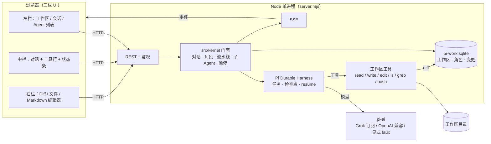

# pi-work 架构

内核是 Pi Durable Harness（`@earendil-works/pi-durable`）。对话、任务、检查点、断点续跑、子 Agent、中止都走 Harness。模型调用走 `@earendil-works/pi-ai`。`server.mjs` 启动时打开 `<dataDir>/harness/session.sqlite` 并 `resume()`。没有环境变量可以切回旧的自写编排器；那个运行循环已经删除。

没有 harness id 的旧对话只读归档。可见的用户和助手文本可以另开一条新对话，不导入旧正文，也不重放工具。

单个 Node >= 22.19 进程，浏览器通过 REST + SSE 通信。



## 关键概念
- **Agent** = 一条 Harness 对话上的运行（角色 + 检查点），可多个并行。
- **Role**：系统提示词、工具白名单、模型。未知工具名在执行前被拒绝（`E_UNKNOWN_TOOL`），不会发出 `tool.start`。
- **Pipeline**：角色有序组合，交接在同一条对话里提交，不另开对话。流水线步骤作为会话的 agent 暴露（`GET /api/conversations/:cid` 的 `agents[]`，SSE `agent` 事件）。子 Agent 是 `delegate` / `subagent` 另开的 Harness 对话。演示见 [SUBAGENTS.md](SUBAGENTS.md)。
- **卡住与重试**：宿主计时器在当前模型或工具步骤结束后提交「继续」，计入 autoContinues；到达上限失败 `E_STALL`。可重试的模型错误由 Harness 重试。暂停等当前步骤结束，不再发出下一步请求。
- **工具沙箱**：所有路径解析后必须位于工作区根目录内；写操作生成 diff 并入库，供右栏展示。`bash` 使用环境变量白名单、进程组 SIGKILL、1 MiB 输出上限；完整 OS 沙箱（bubblewrap）为 v1 之后的工作。
- **Skills**：`skills/<id>/SKILL.md`（前言里的 `id` / `name` / `description` + 正文）。仓库自带的 Skill 与 `$PI_WORK_DATA_DIR/skills` 中用户新建的 Skill 合并，同名时用户副本优先。`settings.skills[id] === false` 表示关闭，缺省为开启。内核在请求模型前，把已开启 Skill 的正文放进系统提示 section。
- **插件**：`plugins/<id>/plugin.json` 声明 `main`（插件目录内的相对 `.mjs`）和 `tools`。加载器 `import()` 该模块，并按工具名查找导出的函数。只有已开启且加载成功的工具会进入模型工具列表，并由 Harness 执行；关闭、冲突或加载失败的名字仍是 `E_UNKNOWN_TOOL`。内置工具白名单不变。导入必须指向本机目录，模块能加载才复制到数据目录；只提交名称和描述会被拒绝。相对路径先按进程工作目录解析，不存在时再按安装目录解析。`examples/plugins/` 下的示例不会自动加载。工具函数收到 `(args, ctx)`，`ctx.workspacePath` 是当前工作区。插件代码在进程内运行，没有额外沙箱。

## 耐久性设计

`src/store/sqlite.mjs` 使用 Node 22 的 `node:sqlite`（`DatabaseSync`）：

- `PRAGMA journal_mode=WAL`
- `PRAGMA busy_timeout=5000`
- `PRAGMA synchronous=NORMAL`
- `schema_version` 表 + `PRAGMA user_version`（当前为 2；迁移时递增）
- 数据库文件与 `auth.token` 权限 `0600`
- 启动时在 `$PI_WORK_DATA_DIR/.lock` 上用 `O_EXCL` 抢单实例锁；若锁文件中的 pid 在 `/proc` 中仍存活则拒绝启动；进程退出时删除锁

**已知限制：** `node:sqlite` 仍带实验性警告，API 可能变化。多进程写入不受支持（靠锁文件保证单实例）。崩溃只在 e2e 层做过部分覆盖。

## 恢复不变量

检查点在 Harness 的 `session.sqlite`。应用库只记展示用的状态、消息投影和 diff。

- `read` / `ls` / `grep` 可以安全重放。`write` / `edit` / `bash` 标成 unsafe：中断后不重放，模型看到 interrupted。
- 进程重启时，带 harness id 且未结束的对话由 `harness.resume()` 接着跑。没有 harness id 的旧行不恢复，读取时状态是 `archived`。
- 暂停等当前模型或工具步骤结束，然后不再发下一步。停止是 `abort`，并且放开后台任务。

## Git 工作区与 worktree

`POST /api/workspaces` 支持 `{name, gitUrl, branch?}`：用 `git clone --depth 1`（`execFile`，无 shell，`--` 分隔 URL，`protocol.file.allow=never` / `protocol.ext.allow=never`）把仓库克隆到 `PI_WORK_DATA_DIR/workspaces/<id>/repo`。仅允许 `https:`、`ssh:` 与 `git@host:path`。存储的 `gitUrl` 会去掉 `user:pass@`。工作区记录额外字段：

```
{ source: 'local' | 'git', gitUrl, branch, rootPath, worktrees: [] }
```

本地 `path` 必须位于 `$PI_WORK_DATA_DIR/workspaces` 或 `$PI_WORK_WORKSPACE_ROOT`（默认 `$HOME/projects` 若存在，否则 `$HOME`）之下，且不得为 `/`、`$HOME` 本身、`~/.ssh`、`~/.gnupg` 或系统目录。省略 `path` 时在 data dir 下创建空仓库目录。

**TODO：git worktree 尚未实现。** `worktrees` 目前恒为空数组，预留给后续 `git worktree add`（每个对话/Agent 独立工作树、互不覆盖工作区文件）。不要在当前版本假设存在多 worktree。

## 鉴权与绑定

- 首次启动若 `PI_WORK_TOKEN` 与 `$PI_WORK_DATA_DIR/auth.token` 皆空，生成 32 字节 hex 令牌并打印 `PI_WORK_LOGIN` / `PI_WORK_TOKEN`。
- `/api/*` 必须 `Authorization: Bearer` 或 cookie `pi_work_token`（HttpOnly, SameSite=Strict）。
- `GET /login?token=` 校验后 Set-Cookie 并 302 `/`。
- SSE 优先 cookie；`POST /api/sse-ticket` 签发 60s 一次性 `?ticket=`。不接受长效 token 作为 query。
- `Host` 必须是 `127.0.0.1:<port>` / `localhost:<port>` / `[::1]:<port>`，可用 `PI_WORK_ALLOWED_HOSTS` 追加。
- 写方法要求 `Content-Type: application/json`；若带 `Origin` 则必须同源。

自定义 `baseUrl` 可指向任意 OpenAI 兼容主机（openai / x.ai / deepseek / anthropic 为常见值）。更换 `baseUrl` 或 `provider` 且请求中没有新的明文 `apiKey` 时，会清空已存密钥，避免把密钥发到攻击者主机。
