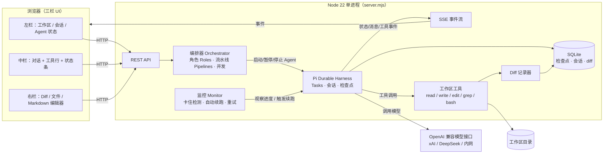

# pi-work 架构

单个 Node 22 进程，浏览器通过 REST + SSE 通信，Pi Durable Harness 负责持久化执行，SQLite 保存检查点。

## 关键概念
- **Agent** = 一个 Durable Task（角色 + 会话 + 检查点），可多个并行。
- **Role**：系统提示词、工具白名单、模型。
- **Pipeline**：角色有序组合，带交接产物和失败回退。
- **Monitor**：每个 Agent 记录最后进展时间；超时或流中断 → 从最近检查点续跑，计数显示在状态条（↻ N）。
- **工具沙箱**：所有路径解析后必须位于工作区根目录内；写操作生成 diff 并入库，供右栏展示。
